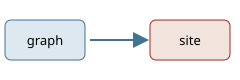

- **Bold**, *italic* and `code` text.
- > A quotation, as a markdown blockquote.
- A code block:
  ```clojure
  (defn greet [name] (str "Hello, " name))
  ```
- An image from the graph's assets folder, which the build copies to the site:
  
- A block with an id, which other blocks can reference:
  id:: 6a1f3c2e-0000-4000-8000-000000000001
	- Nested blocks become nested lists.
- A block reference shows that block's text: ((6a1f3c2e-0000-4000-8000-000000000001))
- Math, rendered by MathJax: $$e^{i\pi} + 1 = 0$$
- TODO A task marker
- DONE A finished one
